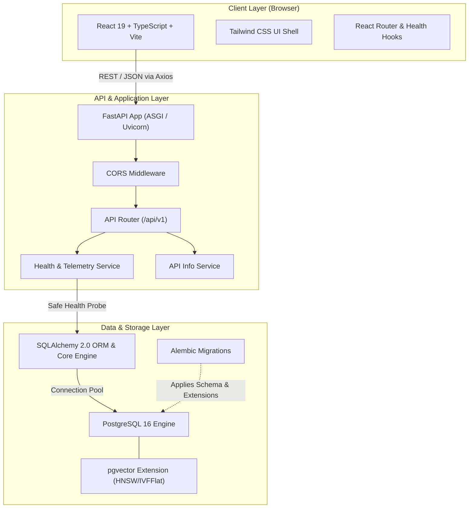

# NeuroQuery — System Architecture

## 1. System Overview

**NeuroQuery** is an end-to-end NLP-powered document intelligence and research platform. It enables semantic analysis, hybrid retrieval (vector similarity + BM25 keyword search), document-grounded question answering (RAG) with verifiable citations, cross-document comparison, and retrieval/generation evaluation.

This document details the architectural foundation established in **Phase 1: Project Architecture and Foundation**.

---

## 2. Architecture Diagram



---

## 3. Technology Stack & Technical Rationale

| Layer | Technology | Selection Rationale |
| :--- | :--- | :--- |
| **Frontend Framework** | React 19, TypeScript | Strict type safety, rich component ecosystem, predictable state management. |
| **Build Tool** | Vite | Instant HMR, native ES modules in development, highly optimized Rollup production builds. |
| **Styling** | Tailwind CSS | Utility-first, zero runtime overhead, responsive layout primitives, seamless dark mode. |
| **Icons & UI** | Lucide React | Lightweight, tree-shakeable, modern consistent icon set. |
| **HTTP Client** | Axios | Request/response interceptors, timeout handling, typed response contracts. |
| **Backend Framework** | FastAPI (Python 3.11+) | Native async support, automatic OpenAPI/Swagger documentation, Pydantic validation, high throughput. |
| **Data Validation** | Pydantic v2 & `pydantic-settings` | High-performance Rust-backed schema validation, environment variable parsing. |
| **ORM / Data Access** | SQLAlchemy 2.0 | Modern typed 2.0 query syntax, robust connection pooling, transactional consistency. |
| **Database Migrations** | Alembic | Trackable, version-controlled schema evolution with custom migration steps. |
| **Database & Vectors** | PostgreSQL 16 + `pgvector` | Battle-tested relational database combined with vector similarity indexing (Cosine, L2, Inner Product) in a single unified data store. |

---

## 4. Repository Structure & Separation of Concerns

```text
NeuroQuery/
├── backend/
│   ├── app/
│   │   ├── api/
│   │   │   └── v1/
│   │   │       ├── endpoints/      # Request handlers (health, root, future docs/rag)
│   │   │       └── router.py       # Aggregate v1 routing definitions
│   │   ├── core/                   # Global configuration, settings, logging
│   │   ├── db/                     # Engine creation, session lifecycle, declarative base
│   │   ├── models/                 # SQLAlchemy ORM entity models
│   │   ├── schemas/                # Pydantic validation & serialization models
│   │   ├── services/               # Core business & domain logic
│   │   ├── utils/                  # Generic reusable helper functions
│   │   └── main.py                 # FastAPI application factory & lifecycle
│   ├── alembic/                    # Database migration environment & versions
│   ├── tests/                      # Automated unit and integration tests
│   ├── requirements.txt            # Production & dev dependencies
│   └── .env.example                # Safe backend environment template
├── frontend/
│   ├── src/
│   │   ├── assets/                 # Static visual assets and styles
│   │   ├── components/             # Reusable UI components (Header, Sidebar, Badges)
│   │   ├── hooks/                  # Custom React hooks (useHealthCheck, useTheme)
│   │   ├── layouts/                # Base layout templates (MainLayout)
│   │   ├── pages/                  # Route views (Dashboard, Documents, Assistant, etc.)
│   │   ├── services/               # HTTP client instances and API endpoint wrappers
│   │   ├── types/                  # Shared TypeScript interfaces & types
│   │   ├── utils/                  # Helper utilities (cn, formatting)
│   │   ├── App.tsx                 # Root application component with routing
│   │   ├── index.css               # Global Tailwind CSS directives & theme variables
│   │   └── main.tsx                # Frontend entrypoint
│   ├── public/                     # Static assets served as-is (favicon, icons)
│   ├── package.json                # Frontend dependencies and scripts
│   └── vite.config.ts              # Vite configuration with dev proxy
├── docs/                           # Architecture, roadmap, and onboarding documentation
├── docker-compose.yml              # Local container orchestrations (PostgreSQL + pgvector)
├── .gitignore                      # Multi-language Git exclusion rules
├── LICENSE                         # Project open-source license
└── README.md                       # Main documentation & getting started guide
```

---

## 5. Backend Architecture & Resilience Patterns

### 5.1 Graceful Database Degradation
The backend must boot and serve HTTP requests even if PostgreSQL is offline or restarting.
- **Engine Initialization**: The SQLAlchemy engine is instantiated at startup without making eager blocking network calls.
- **Safe Health Probing**: The `/api/v1/health` endpoint tests connectivity using a short socket timeout.
  - If PostgreSQL is reachable: Executes `SELECT 1` and verifies `pgvector` presence via `pg_extension`. Reports `"connected": true` and `"vector_extension": true`.
  - If PostgreSQL is unreachable: Catches connection exceptions safely, logs the diagnostic message internally, and responds with `"connected": false` and `"vector_extension": false` without crashing the application or returning a 500 error that crashes health checks.
- **No Credential Leaks**: Connection errors in responses are sanitized to prevent database credentials, hostnames, or internal IPs from leaking to clients.

### 5.2 Centralized Configuration
- Configured via `pydantic-settings` in `app/core/config.py`.
- Enforces strict type validation on environment variables (ports, database URLs, CORS origins).
- Follows the Twelve-Factor App methodology.

---

## 6. Database & Migration Strategy

- **SQLAlchemy 2.0 Declarative Base**: Base metadata defined in `app/db/base.py`.
- **Alembic Environment**: Configured in `backend/alembic/` to import `Base.metadata`.
- **pgvector Integration**:
  - The migration script includes `op.execute("CREATE EXTENSION IF NOT EXISTS vector;")` to ensure vector operations (`vector` type, `<=>`, `<#>` operators) are available.
  - Future phases will define embedding columns using `from pgvector.sqlalchemy import Vector`.

---

## 7. Frontend Architecture

- **Layout Structure**: Collapsible responsive sidebar, dynamic header with environment and real-time backend connection status badge.
- **Real-time Health Checking**: `useHealthCheck` hook polls the backend health status periodically (every 30 seconds) and provides immediate status indication (Connected, Degraded, Disconnected).
- **Theme Support**: Light mode as default research UI, with dark mode toggle powered by Tailwind CSS class strategy.
- **Extensible Pages**:
  - **Dashboard**: System overview, architecture summary, live telemetry, and roadmap tracking.
  - **Documents**: Planned ingestion pipeline placeholder.
  - **Research Assistant**: Planned conversational RAG placeholder.
  - **Document Comparison**: Planned multi-document contradiction & diff placeholder.
  - **Evaluation Lab**: Planned retrieval & faithfulness metrics placeholder.

---

## 8. Security & Compliance

1. **Environment Separation**: No `.env` files are tracked in source control. Comprehensive `.env.example` files guide developers.
2. **CORS Governance**: Configurable allowed origins (`BACKEND_CORS_ORIGINS`) defaulting strictly to development host ports (`http://localhost:5173`, `http://127.0.0.1:5173`).
3. **No Unauthenticated Secret Leaks**: Health and diagnostic endpoints report operational boolean status without exposing underlying connection strings or credentials.
